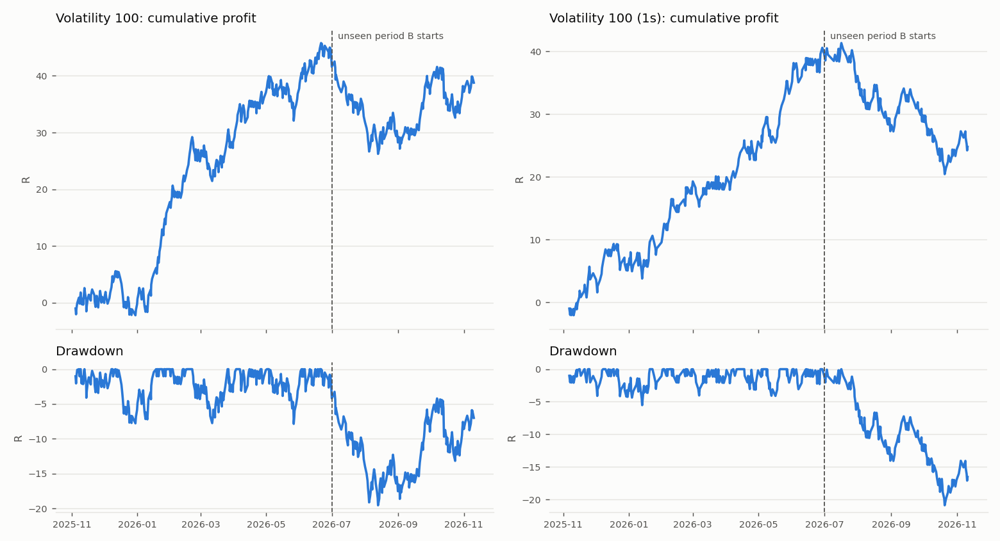

# Volatility 100 and Volatility 100 (1s): wide strategy search

**Verdict: No strategy survived. Do not trade any of these settings as an edge.**

## Method, fixed before the run
- **Data:** real Deriv 5-minute candles, 2025-11-03 to 2026-11-10. Deriv keeps about one year.
- **Tests:** 3,168 settings per market. 22 entry rules (trend, momentum, breakout, mean reversion, market structure, price action) x 4 timeframes x 3 stops x 4 exits x 3 volatility filters.
- **Periods:** A (to 30 Jun 2026) ranks and chooses. B (from 2026-07-01) only scores the choice. Walk-forward repeats the choice 5 times from 1 Mar 2026.
- **Costs:** assumed 0.4 spread + 0.1 slippage per trade, no commission. Swap is not charged. Real MT5 values are unverified.
- **No look-ahead:** decisions use closed candles, fills use the next open, and a test confirms cutting off future candles changes no past signal. Stop beats target if both are hit inside one 5-minute candle.
- **Ranking:** t value in A multiplied by the share of 7 checks that were profitable (4 time slices, 3 market conditions), with at least 60 trades in A.
- **Luck check:** the identical search on shuffled candles, where no pattern can exist.

## Files
`output/all_tests_*.csv` (every setting and every measure), `output/chosen_trades_*.csv`, `output/walk_forward_trades_*.csv`, `output/luck_table.csv`, `output/equity_and_drawdown.png`. Code: `fetch_data.py`, `rules.py`, `engine.py`, `metrics.py`, `search.py`, `report.py`, `test_quant.py`.

## Limits
- One year of data, and period B was also the unseen period in earlier Vix studies, so it is not completely fresh.
- Spread and slippage are assumptions. Stop and target order inside a 5-minute candle is unknown, so the stop is assumed first.
- Deriv describes these markets as generated by a random number process, so the expected finding is no edge.

## Volatility 100 (R_100)

**5 of 9 checks passed: NOT an edge.**
Highest-ranked strategy from period A: `ema_cross(9,21) 30m stop 2 ATR RR 1 vol any`

- **Entry:** Trend following: buy when the fast average crosses above the slow one, sell on the reverse. Parameters: 9,21. Timeframe: 30 minutes.
- **Fill:** open of the candle after the signal candle closes. One trade at a time.
- **Volatility filter:** No volatility filter.
- **Stop-loss:** 2 x ATR(14, Wilder) of the signal candle's timeframe, from the fill.
- **Exit:** Take profit at 1 times the stop distance from entry. The stop can end the trade first; any trade still open after 200 candles closes at the next open.

### Results of that strategy
| Measure | Period A | Period B (unseen) | Whole year |
|---|---|---|---|
| Total trades | 350 | 186 | 536 |
| Win rate | 57.7% | 51.1% | 55.4% |
| Profit factor | 1.27 | 0.97 | 1.16 |
| Net profit | +41.6R | -2.8R | +38.8R |
| Max drawdown | 7.9R | 16.3R | 19.6R |
| Average win | +0.97R | +0.96R | +0.96R |
| Average loss | -1.04R | -1.04R | -1.04R |
| Realised reward:risk | 0.93 | 0.93 | 0.93 |
| Expectancy per trade | +0.119R | -0.015R | +0.072R |
| Sharpe (annual, daily R) | 2.88 | -0.35 | 1.72 |
| t value | 2.24 | -0.21 | 1.68 |
| Longest win / loss streak | 9 / 6 | 6 / 9 | 9 / 9 |
| Spread + slippage paid | 12.4R | 6.8R | 19.2R |
| Net with costs doubled | +29.2R | -9.6R | +19.6R |

Whole year by condition: sideways +16.2R, bull +9.5R, bear +12.8R. Buys +22.3R, sells +16.5R.
Buy and hold: period A -69.3%, period B +93.3%. At 1% risk per trade the strategy made about +41.6% and -2.8%, before compounding.

### Pass marks
| Check | Result |
|---|---|
| Period A: profit, PF above 1.1, t at least 2 | PASS |
| Unseen period B: profitable, PF above 1 | FAIL |
| Walk-forward: profitable overall | PASS |
| Still profitable with costs doubled | PASS |
| Profitable in bull, bear and sideways | PASS |
| Year profit is larger than its worst drawdown | PASS |
| Beats buy and hold in period B at 1% risk | FAIL |
| Beats luck on selection (under 5% of shuffles match it) | FAIL |
| Beats luck on walk-forward (under 5% of shuffles match it) | FAIL |

### Top 10, ranked on period A only
| # | Setting | Score A | Trades A | Win A | PF A | Net R A | DD A | Sharpe A | Trades B | Win B | PF B | Net R B | Exp B |
|---|---|---|---|---|---|---|---|---|---|---|---|---|---|
| 1 | ema_cross(9,21) 30m stop 2 ATR RR 1 vol any | 2.24 | 350 | 57.7% | 1.27 | +41.6 | 7.9 | 2.88 | 186 | 51.1% | 0.97 | -2.8 | -0.015 |
| 2 | engulfing() 240m stop 1 ATR RR 1 vol any | 2.06 | 137 | 59.9% | 1.42 | +23.8 | 5.2 | 2.60 | 72 | 54.2% | 1.12 | +4.1 | +0.057 |
| 3 | bollinger_reversion(20,2.0) 30m stop 2 ATR RR 3 vol any | 2.00 | 273 | 31.5% | 1.32 | +61.6 | 12.1 | 2.69 | 146 | 26.7% | 1.03 | +3.7 | +0.025 |
| 4 | ema_cross(20,50) 15m stop 3 ATR RR 1 vol any | 1.89 | 305 | 57.0% | 1.24 | +32.8 | 8.2 | 2.52 | 182 | 49.5% | 0.91 | -8.4 | -0.046 |
| 5 | bollinger_reversion(20,2.0) 30m stop 2 ATR opposite signal vol high | 1.77 | 209 | 42.1% | 1.40 | +50.5 | 14.6 | 2.78 | 108 | 40.7% | 0.96 | -2.4 | -0.022 |
| 6 | rsi_reversion(14,30,70) 30m stop 2 ATR RR 3 vol high | 1.73 | 137 | 34.3% | 1.48 | +44.7 | 24.1 | 2.61 | 61 | 36.1% | 1.58 | +23.5 | +0.386 |
| 7 | rsi_reversion(14,30,70) 60m stop 2 ATR RR 1 vol any | 1.71 | 116 | 60.3% | 1.45 | +21.1 | 9.5 | 2.61 | 54 | 50.0% | 0.95 | -1.5 | -0.028 |
| 8 | rsi_reversion(14,30,70) 30m stop 2 ATR RR 2 vol high | 1.70 | 148 | 42.6% | 1.41 | +35.9 | 17.1 | 2.64 | 62 | 40.3% | 1.28 | +10.8 | +0.174 |
| 9 | rsi_reversion(14,30,70) 60m stop 1 ATR RR 2 vol any | 1.70 | 141 | 43.3% | 1.42 | +35.0 | 15.0 | 2.75 | 65 | 32.3% | 0.88 | -5.5 | -0.085 |
| 10 | ema_cross(20,50) 15m stop 2 ATR RR 2 vol high | 1.64 | 215 | 41.4% | 1.31 | +41.5 | 8.0 | 2.36 | 123 | 33.3% | 0.93 | -6.2 | -0.051 |

### Walk-forward
| Unseen window | Chosen on earlier data | Trades | Net R |
|---|---|---|---|
| 2026-03-01 to 2026-04-20 | bollinger_reversion(20,2.5) 15m stop 2 ATR RR 1 vol low | 26 | -5.2 |
| 2026-04-20 to 2026-06-10 | ema_cross(9,21) 30m stop 2 ATR RR 1 vol any | 79 | +7.3 |
| 2026-06-10 to 2026-07-31 | bollinger_reversion(20,2.0) 30m stop 2 ATR opposite signal vol high | 45 | -8.4 |
| 2026-07-31 to 2026-09-20 | bollinger_reversion(20,2.5) 60m stop 3 ATR RR 2 vol any | 9 | +1.1 |
| 2026-09-20 to 2026-11-10 | rsi_reversion(14,30,70) 30m stop 2 ATR RR 3 vol high | 26 | +11.9 |

### Luck check (40 shuffled histories)
| Measure | Real prices | Median of shuffled | Shuffled at or above real |
|---|---|---|---|
| Best selection score in A | 2.24 | 2.63 | 75.6% |
| That choice in B (net R) | -2.8 | -4.5 | 48.8% |
| Walk-forward (net R) | +6.6 | -2.4 | 22.0% |

### Did good settings stay good?
Of 1,925 settings with at least 60 trades in A: 409 made money in A, 435 in B, 138 in both. Rank correlation of expectancy between A and B: +0.209.

## Volatility 100 (1s) (1HZ100V)

**4 of 9 checks passed: NOT an edge.**
Highest-ranked strategy from period A: `rsi_reversion(2,10,90) 60m stop 2 ATR RR 1 vol high`

- **Entry:** Mean reversion: buy when RSI climbs back out of oversold, sell when it falls back out of overbought. Parameters: 2,10,90. Timeframe: 60 minutes.
- **Fill:** open of the candle after the signal candle closes. One trade at a time.
- **Volatility filter:** Only when ATR/price is above its 200-candle median.
- **Stop-loss:** 2 x ATR(14, Wilder) of the signal candle's timeframe, from the fill.
- **Exit:** Take profit at 1 times the stop distance from entry. The stop can end the trade first; any trade still open after 200 candles closes at the next open.

### Results of that strategy
| Measure | Period A | Period B (unseen) | Whole year |
|---|---|---|---|
| Total trades | 258 | 147 | 405 |
| Win rate | 58.1% | 46.3% | 53.8% |
| Profit factor | 1.35 | 0.83 | 1.13 |
| Net profit | +38.5R | -13.8R | +24.8R |
| Max drawdown | 5.5R | 20.9R | 20.9R |
| Average win | +0.99R | +0.98R | +0.98R |
| Average loss | -1.01R | -1.02R | -1.01R |
| Realised reward:risk | 0.97 | 0.96 | 0.97 |
| Expectancy per trade | +0.149R | -0.094R | +0.061R |
| Sharpe (annual, daily R) | 3.28 | -2.07 | 1.38 |
| t value | 2.43 | -1.14 | 1.23 |
| Longest win / loss streak | 10 / 4 | 4 / 5 | 10 / 5 |
| Spread + slippage paid | 3.5R | 2.3R | 5.8R |
| Net with costs doubled | +35.1R | -16.1R | +19.0R |

Whole year by condition: sideways +3.8R, bull +5.8R, bear +11.4R. Buys +20.1R, sells +4.7R.
Buy and hold: period A -7.8%, period B +65.5%. At 1% risk per trade the strategy made about +38.5% and -13.8%, before compounding.

### Pass marks
| Check | Result |
|---|---|
| Period A: profit, PF above 1.1, t at least 2 | PASS |
| Unseen period B: profitable, PF above 1 | FAIL |
| Walk-forward: profitable overall | FAIL |
| Still profitable with costs doubled | PASS |
| Profitable in bull, bear and sideways | PASS |
| Year profit is larger than its worst drawdown | PASS |
| Beats buy and hold in period B at 1% risk | FAIL |
| Beats luck on selection (under 5% of shuffles match it) | FAIL |
| Beats luck on walk-forward (under 5% of shuffles match it) | FAIL |

### Top 10, ranked on period A only
| # | Setting | Score A | Trades A | Win A | PF A | Net R A | DD A | Sharpe A | Trades B | Win B | PF B | Net R B | Exp B |
|---|---|---|---|---|---|---|---|---|---|---|---|---|---|
| 1 | rsi_reversion(2,10,90) 60m stop 2 ATR RR 1 vol high | 2.43 | 258 | 58.1% | 1.35 | +38.5 | 5.5 | 3.28 | 147 | 46.3% | 0.83 | -13.8 | -0.094 |
| 2 | rsi_reversion(2,10,90) 60m stop 2 ATR RR 2 vol high | 2.21 | 155 | 42.6% | 1.45 | +40.9 | 7.1 | 2.68 | 106 | 39.6% | 1.26 | +16.9 | +0.159 |
| 3 | bollinger_reversion(20,2.0) 30m stop 3 ATR RR 2 vol any | 2.20 | 186 | 43.5% | 1.49 | +51.7 | 12.1 | 3.11 | 129 | 38.0% | 1.18 | +14.9 | +0.115 |
| 4 | ema_cross(50,200) 15m stop 2 ATR RR 2 vol low | 2.12 | 75 | 46.7% | 1.67 | +27.7 | 6.2 | 2.75 | 32 | 37.5% | 1.14 | +2.8 | +0.089 |
| 5 | bollinger_reversion(20,2.0) 60m stop 2 ATR RR 1 vol high | 2.04 | 157 | 61.8% | 1.57 | +35.0 | 11.6 | 3.53 | 92 | 45.7% | 0.81 | -9.4 | -0.103 |
| 6 | bollinger_reversion(20,2.0) 30m stop 3 ATR RR 1 vol high | 1.98 | 248 | 56.9% | 1.29 | +30.9 | 6.1 | 2.36 | 136 | 51.5% | 1.03 | +1.8 | +0.014 |
| 7 | rsi_reversion(2,10,90) 60m stop 3 ATR RR 1 vol any | 1.96 | 213 | 58.2% | 1.37 | +33.0 | 8.1 | 2.70 | 125 | 51.2% | 1.02 | +1.0 | +0.008 |
| 8 | bollinger_reversion(20,2.0) 30m stop 1 ATR RR 2 vol high | 1.94 | 372 | 39.5% | 1.24 | +55.1 | 17.6 | 2.57 | 199 | 36.7% | 1.08 | +11.1 | +0.056 |
| 9 | bollinger_reversion(20,2.0) 15m stop 3 ATR RR 1 vol high | 1.94 | 480 | 56.0% | 1.23 | +49.3 | 18.7 | 2.82 | 267 | 53.2% | 1.09 | +11.6 | +0.043 |
| 10 | rsi_reversion(2,10,90) 30m stop 1 ATR RR 3 vol low | 1.92 | 497 | 30.0% | 1.22 | +78.4 | 31.1 | 2.54 | 282 | 28.0% | 1.09 | +20.1 | +0.071 |

### Walk-forward
| Unseen window | Chosen on earlier data | Trades | Net R |
|---|---|---|---|
| 2026-03-01 to 2026-04-20 | bollinger_reversion(20,2.0) 30m stop 3 ATR RR 2 vol any | 36 | +11.6 |
| 2026-04-20 to 2026-06-10 | bollinger_reversion(20,2.0) 30m stop 3 ATR RR 2 vol any | 42 | -2.0 |
| 2026-06-10 to 2026-07-31 | bollinger_reversion(20,2.0) 30m stop 3 ATR RR 2 vol any | 45 | -0.8 |
| 2026-07-31 to 2026-09-20 | bollinger_reversion(20,2.0) 60m stop 2 ATR RR 1 vol high | 38 | -4.7 |
| 2026-09-20 to 2026-11-10 | rsi_reversion(14,20,80) 15m stop 1 ATR RR 1 vol high | 8 | -4.4 |

### Luck check (40 shuffled histories)
| Measure | Real prices | Median of shuffled | Shuffled at or above real |
|---|---|---|---|
| Best selection score in A | 2.43 | 2.75 | 75.6% |
| That choice in B (net R) | -13.8 | -4.6 | 73.2% |
| Walk-forward (net R) | -0.2 | -0.0 | 51.2% |

### Did good settings stay good?
Of 1,958 settings with at least 60 trades in A: 431 made money in A, 1,018 in B, 229 in both. Rank correlation of expectancy between A and B: -0.035.
